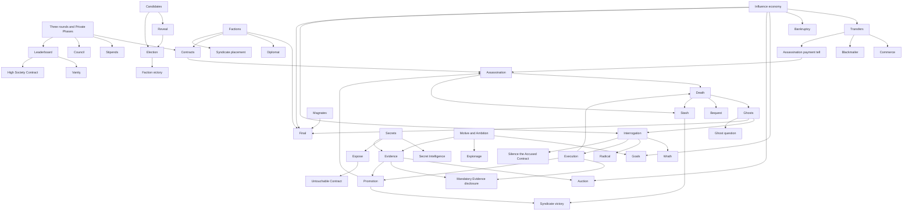

# The Dark Council — Rule Dependency Map

This map answers Tier 2 of the load-bearing analysis: what else silently breaks if an
element is removed? A dependency is not proof that the element is good; it means a cut
must include and retest its dependants.

## Core dependency graph

## Element-by-element dependencies

| Element | Direct dependants | Removal consequence |
|---|---|---|
| Three-round structure | Contracts, stipends, deadlines, Leaderboards, one kill/Launder/withdrawal per round | Requires a full timing and economy redesign. |
| Private Phase | Negotiation, legal transfers, assassination submission, Laundering, Commerce, Blackmailer | Removes the principal social loop and several Goals. |
| Council | assassination reveal, Ghost question, Expose, Interrogation, public convergence | Removes the only scheduled whole-table information point. |
| Influence | transfers, costs, rewards, Bankruptcy, Leaderboards, Auction, nomination rights, vote buying, Magnate/Syndicate totals | Nearly every mechanical system depends on it. |
| Bankruptcy | negative penalties, Candidate eligibility, personal Faction eligibility | Penalties can become free when a player has no chips; live playtest already confirms abuse. |
| Factions | Candidates, election victory, Diplomat, faction Contracts, Syndicate composition, Magnate bluff | Removing or revealing them changes the game's coalition problem. |
| Hidden Faction membership | faction claims, Reveal value, coalition discovery, Magnate bluff | Open factions turn negotiation into known-team coordination. |
| Magnate economic victory | Magnate bargaining position, cross-faction vote deals, hoarding/spending tension | Removes intentional kingmakers and a major demand source for Influence. |
| Syndicate roles | assassination, Laundering, Promotion, Evidence subject, Syndicate victory | Removes the hidden-role deduction layer. |
| Motive + Ambition | eight Goals, Espionage, two Evidence templates, Promotion lead options | Cannot be cut locally; Espionage becomes self-referentially invalid and Evidence must be rewritten. |
| Secrets | Expose, Secret Intelligence, one Evidence template, Untouchable Contract, Promotion lead option | Removes a complete information-and-economy layer. |
| Starting Advantages | initial private information distribution, Evidence holders, Secret Intelligence, one Evidence template | Changes the initial information arc and Burn the Evidence targets. |
| Five Evidence / two false | deduction noise budget, Starting Advantages, Auction prize, forced disclosure | Changing count or reliability requires regenerating setup and player expectations. |
| Exact Evidence disclosure | information convergence after Execution | Without it, Evidence can remain private or be paraphrased beyond auditability. |
| Contracts | Syndicate kill pressure, Stash gain/loss, several public target signals | Without them, kill choice can become purely optimal threat removal. |
| Leaderboard | Vanity, High Society Contract, public wealth signal | Also informs bargaining and exposes economic leaders. |
| Expose | Secret information has material value; Untouchable Contract state | Removing it leaves Secret Intelligence with no direct public action. |
| One-Expose limit | Expose economy | Removing the limit reopens repeat farming. |
| Interrogation | Wrath, Radical, Silence the Accused, Execution, Promotion, forced Evidence disclosure | It is the principal collective deduction action. |
| Escalating Interrogation cost | accusation scarcity and timing | Flat/free accusations can make repeated low-confidence trials dominant. |
| Guilty-vote stakes | personal reason to hunt carefully; Radical completion economics | Changing them alters both deduction incentives and Influence flow. |
| Execution truth reveal | verified progress, Promotion trigger, social accountability | Without it, the room cannot learn whether its collective action was correct. |
| Auction | Collector, guaranteed truthful Evidence, public willingness-to-pay signal | Collector becomes impossible and one hard Evidence source disappears. |
| Death split and bequest | Stash income, Bank sink, social inheritance, Ghost transition | Changes faction wealth and the meaning of choosing an heir. |
| Ghost status | continued participation, private question, Interrogation and Final votes | Removing it creates hard player elimination and changes majority thresholds. |
| Ghost question | dead-player information agency | Removing it reduces Ghost coordination to voting and persuasion based on old information. |
| Three nominators/Candidates | ballot diversity, nomination power of richest players | Candidate count changes faction lockout and spoiler rates. |
| Bankruptcy Candidate restriction | nomination legality | Without it, a player can ignore debt and still become the Faction's champion. |
| Reveal after nomination | hard Faction information applied to a relevant Final choice | Reordering changes expected value of the Reveal. |
| Buy Reveal votes | Influence can steer which political truth becomes public | Removing it weakens wealth's information-market role. |
| Buy Final votes | Influence deals have endgame value; Magnates can sell support; spending reduces victory totals | Removing it changes the entire economic endgame. |
| Three-candidate plurality | spoiler risk and coalition negotiation | A runoff changes strategic voting and should be treated as a complete election variant. |
| Kill tell | physical precondition and trace for assassination | Without it, kills have no material preparation or donor evidence. |
| Either-member payer | ambiguity in the kill tell | Removing it restores a direct Assassin-identification channel. |
| Cumulative payment scope | early deals can become later danger; reduces same-round tell certainty | Removing it makes recent donors disproportionately incriminating. |
| Stash | Syndicate progress, death skim, Contract economy, Laundering | Syndicate victory thresholds and Accomplice role depend on it. |
| Launder | Accomplice agency and inherited progress | Without it the Accomplice becomes mainly a courier/backup role. |
| Stash withdrawal | recurring cash-versus-victory choice | Without it Laundering is one-way and may become automatic. |
| Promotion | succession, second Assassin, inherited Stash, survivor lead | Removing it ends or fundamentally changes the Syndicate after one correct Execution. |
| Player-count scaling | faction composition and reachable victory totals | A single flat setup is not portable across 8–15 players. |

## High-cascade clusters

These elements cannot be evaluated as isolated cuts:

1. **Goals cluster:** Motive + Ambition, Espionage, Goal rewards, dealing caps,
   Leaderboard, Auction, Interrogation, transfers.
2. **Information cluster:** Secrets, Secret Intelligence, Evidence, Expose, forced
   disclosure, Auction, Promotion lead.
3. **Execution cluster:** Interrogation, vote stakes, death, Ghosts, Evidence
   disclosure, Promotion, Stash wipeout.
4. **Economic Final cluster:** Influence, Magnates, nomination rights, Reveal buying,
   vote buying, Bankruptcy, victory checks.
5. **Syndicate operation cluster:** Contracts, kill tell, either-member payer,
   assassination, Stash, Laundering, withdrawal, Promotion.

## Tier 2 conclusion

The ruleset is highly interdependent. Most major mechanics are **Structural**, not
Decorative. The complexity audit must therefore prefer presentation changes unless
Tier 1, Tier 3, and Tier 4 all show that an entire cluster can be removed safely.
